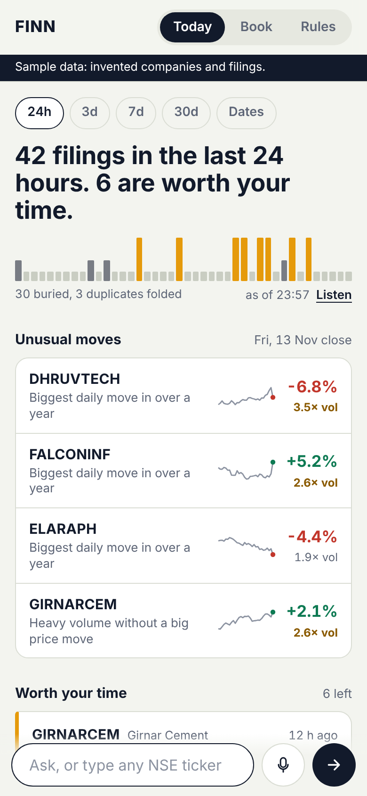
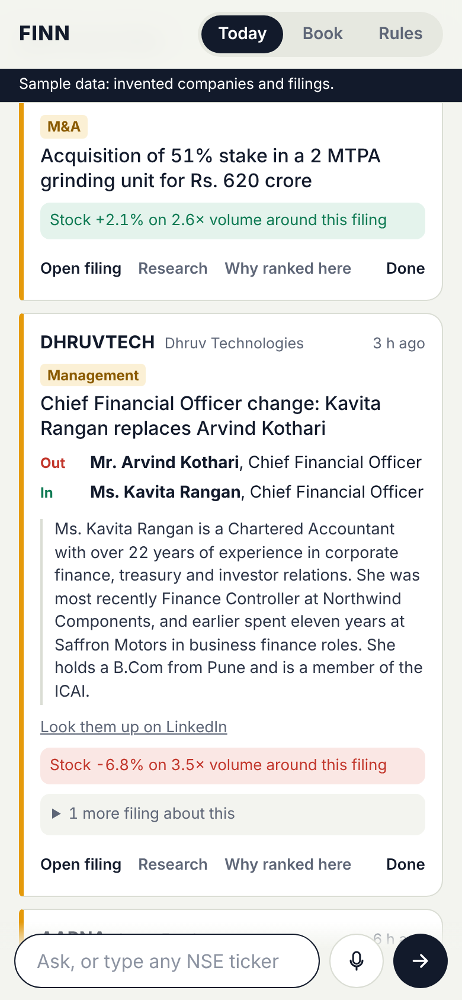
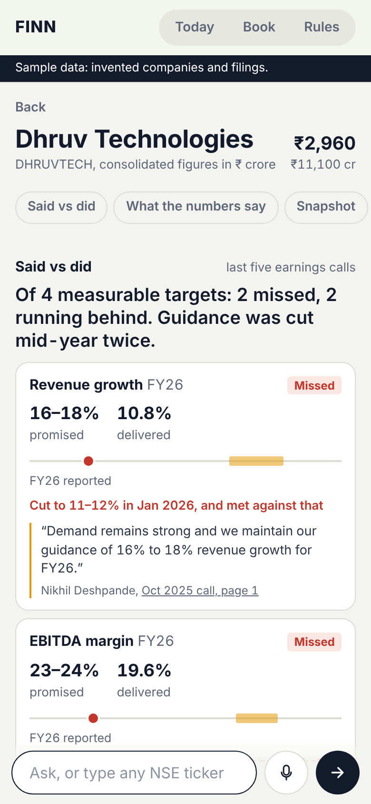
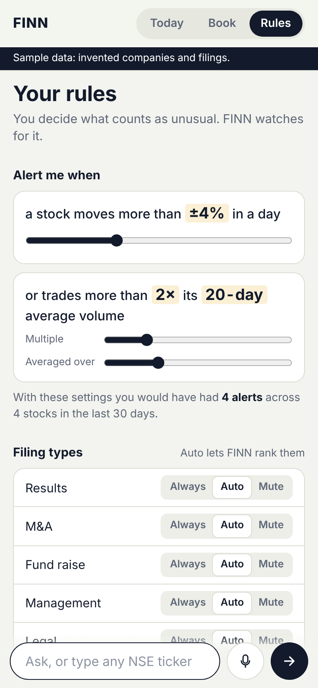

# FINN — Financial Investment Agent

A mobile-first product for one question an investor asks all day: **what changed in my
book, and what of it matters?** FINN reads every exchange filing and end-of-day move
for a portfolio, surfaces the few that deserve attention, buries the rest, and on demand
checks a company's management against its own numbers.

| Today | Cards | Said vs did | Rules |
|---|---|---|---|
|  |  |  |  |

Screenshots are from sample mode (invented companies). Run `python -m finn.warm` for real data.

## Run it

```bash
pip install -r requirements.txt
python -m finn.doctor          # checks every live source from this machine, in ~10 seconds
python -m finn                 # http://localhost:8000  (open it on a phone on the same Wi-Fi)
```

No API key is needed. To add model-based reading, copy `.env.example` to `.env`.
`FINN_SAMPLE=1 python -m finn` runs fully offline on generated fixtures. `pytest` runs 57 tests.

## The point of view

1. **A tape you finish, not a feed you scroll.** The first screen is a sentence and a
   strip of ticks: one per filing, with the few that matter standing tall. Each card has
   a Done button, and the screen ends at "You're caught up."
2. **Every ranking is inspectable.** "Why ranked here" shows the arithmetic: the filing
   type, the rupees involved, your position size, and whether the stock moved around it.
3. **The model reads; the code counts.** A model may find the sentence where management
   promises 16–18% growth. Code checks that the quote exists word for word in the
   transcript and compares it with reported revenue. A model can miss a promise, but it
   cannot invent one or get the sum wrong.
4. **You define "unusual".** Thresholds are sliders phrased as a sentence, with a live
   count of how often those settings would have alerted you in the last 30 days.
5. **One input for everything.** The bar at the bottom takes a ticker, a company name, a
   question ("what did they say about margins?") or "what changed this week", typed or
   spoken. The brief can also be read aloud.

## What is built

**Push**
- Windowed digest: 24h / 3d / 7d / 30d / any dates. Filings are classified into the
  brief's 17 categories plus a sub-type, scored, and split into *worth your time*, *good
  to know* (one line each) and *buried* (collapsed counts).
- The same event filed three times (outcome, press release, deck) is shown once.
- Triggered alerts on end-of-day data with configurable price %, volume multiple and
  lookback, each with context ("biggest daily move in over a year").
- Confluence: a filing gains rank when the stock moved unusually around it.
- Results card: Revenue, EBITDA, PBT, PAT with QoQ and YoY, and margin against a year ago.
- Management card: who is out, who is in, and the profile SEBI requires companies to
  attach to the filing, plus a one-tap LinkedIn lookup.
- Coming up: board-meeting and record dates pulled from notices.
- Notifications while the app is open, and `python -m finn.watch` pushes to Telegram on a
  schedule when it is closed.

**Pull** (works for any NSE ticker found on screener.in, not just the book)
- **Said vs did**: numeric guidance from the last five earnings calls, each scored
  against reported numbers: met, missed, running behind after N quarters, or cut mid-year.
- What the numbers say: about a dozen computed observations, each with its evidence.
- Snapshot, 10-year trajectory, balance sheet, cash quality, business, both sides.
- Grounded only in the company's own filings, transcripts and standardised statements.

## Accounts, access and operations

Reading is open: a visitor is a **guest** and can use everything on the rules path.
Signing in as an **analyst** switches on model reading (which costs money) and higher
limits; an **admin** also sees live operations: latency per route, errors, rate-limit
hits and the sign-in audit. Sessions are signed tokens, passwords are scrypt hashes in
configuration, and every request carries a request ID, security headers and a JSON log
line. The full design, including what changes at scale, is in
[docs/SYSTEM_DESIGN.md](docs/SYSTEM_DESIGN.md).

```bash
python -m finn.users secret              # FINN_SECRET, signs sessions
python -m finn.users add manas admin     # prompts for a password, prints a FINN_USERS entry
```

Without `FINN_USERS` the server runs in open mode (everyone is an analyst), which is
the right default on your own machine.

## Architecture

```
phone (web/, no build step)  ──HTTP──►  finn/app.py (Flask, stateless)
                                          │
        ┌───────────────┬─────────────────┼──────────────────┬──────────────┐
   digest.py        research.py      narrative.py          ask.py        enrich.py
   push pipeline    computed          said-vs-did           router +      results first cut,
                    sections+flags    ledger                BM25 QA       management profile
        │               │                 │                  │               │
   classify.py      sources/screener  sources/docs       llm.py  ◄── only reading steps
   alerts.py        sources/prices    (PDF → page text)   (2 tiers, cache, cost ledger)
   sources/announcements (NSE → BSE → saved copy)
                                          │
                                   cache.py (one SQLite file)
```

The phone holds the portfolio, rules and triage state; the server holds none, so a
free-tier host can restart at will.

### Where a model is used, and where it is not

| Step | How | Cost |
|---|---|---|
| Classify and rank filings | 39 ordered regex rules + scoring | zero |
| Threshold alerts, rarity, 52-week context | arithmetic | zero |
| Results first cut | standardised quarterly table | zero |
| Financial sections and observations | arithmetic on statements | zero |
| Find guidance in transcripts | rules; or **fast** model on pre-filtered passages (~20% of the transcript) | small |
| Verify quotes, score promises | string match + arithmetic | zero |
| Management background, one-line summaries | **fast** model, first pages only, on demand | small |
| Read across the record (2 sentences, both sides) | **smart** model on ~1 KB of checked facts | one call per company |

Model outputs are cached forever by prompt hash, filings and transcripts never change
once published, and Rules → Engine shows calls, cache hits and spend. With no key
configured every feature still works on the rules path.

## Deploying

Exchanges refuse some cloud IP ranges, so pick by what `finn.doctor` says:

- **Fastest and most reliable for a demo:** run on a laptop in India and expose it with a
  tunnel (`cloudflared tunnel --url http://localhost:8000`).
- **Hosted:** `render.yaml` and `Dockerfile` are included. Run `python -m finn.warm` on
  your laptop first and commit `data/finn.db`; if the host is blocked by an exchange,
  FINN serves that saved copy and says so on screen.

## What was verified, and what was not

This was built in a sandbox without internet access, so be clear-eyed:

- **Verified:** the whole pipeline end to end on fixtures generated in each source's
  format; 45 tests; every screen driven in a 390 px browser; behaviour when every source
  is unreachable.
- **Checked against the real thing:** NSE's announcement record fields and screener.in's
  section names, row labels and document links.
- **Not yet run live:** the HTTP calls to Yahoo, NSE, BSE and screener.in, PDF downloads,
  and any model call. `python -m finn.doctor` exercises each of these in turn; fix
  whatever it reports before a demo.

## Deliberately left out

- Intraday data: the brief specifies end-of-day.
- Reading results PDFs for the first cut. Many are scans; the standardised table is
  exact and free. The card says so when the table has not caught up with a filing.
- Scraping LinkedIn (against its terms). The filing's own profile is a primary source.
- Server-side user data. Portfolios and rules live on the phone; push when the app is closed needs them server-side (see the scaling table in docs/SYSTEM_DESIGN.md).
- Embeddings. BM25 over three transcripts is enough and costs nothing.

## Repo map

```
finn/app.py            API + static serving        finn/digest.py     push pipeline
finn/classify.py       rules, scores, tiers        finn/alerts.py     thresholds
finn/enrich.py         first cut, management       finn/research.py   computed sections
finn/narrative.py      said-vs-did ledger          finn/ask.py        ask bar
finn/llm.py            model routing + ledger      finn/cache.py      SQLite cache
finn/auth.py           sign-in, roles, limits      finn/ops.py        logs, metrics, headers
finn/sources/          prices, filings, fundamentals, documents
finn/doctor.py warm.py watch.py users.py           command-line tools
finn/sample.py         offline fixtures            web/               the app (3 files)
```
